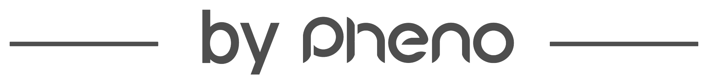
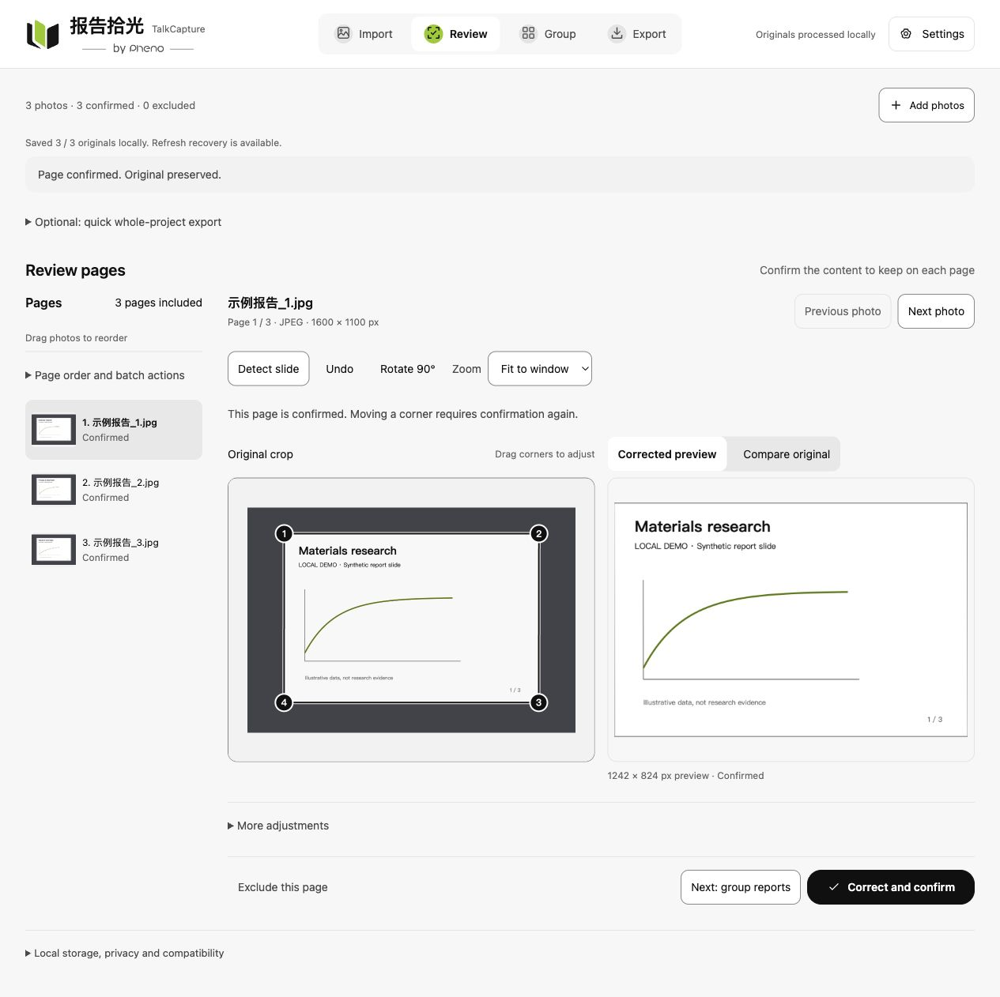
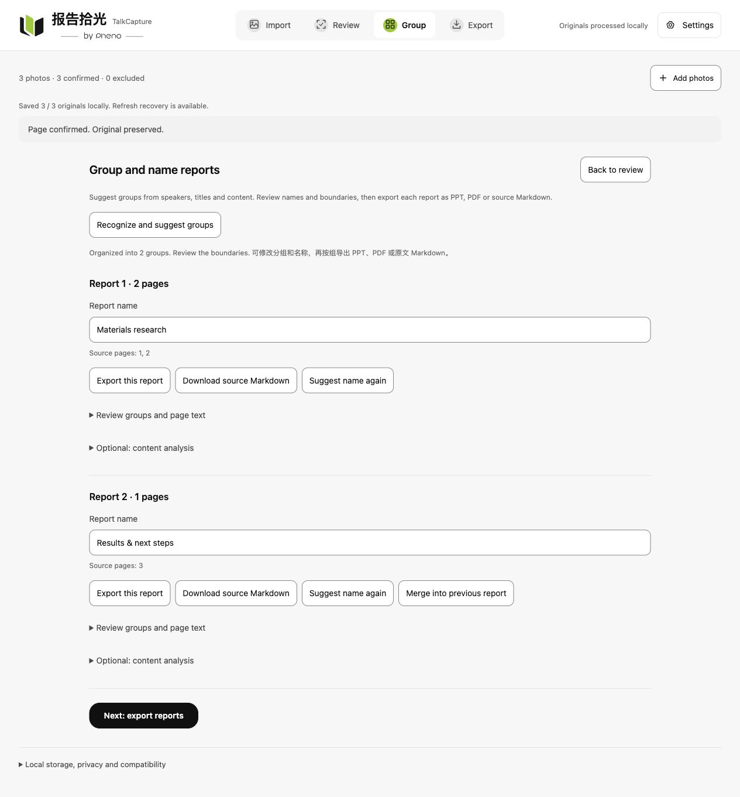
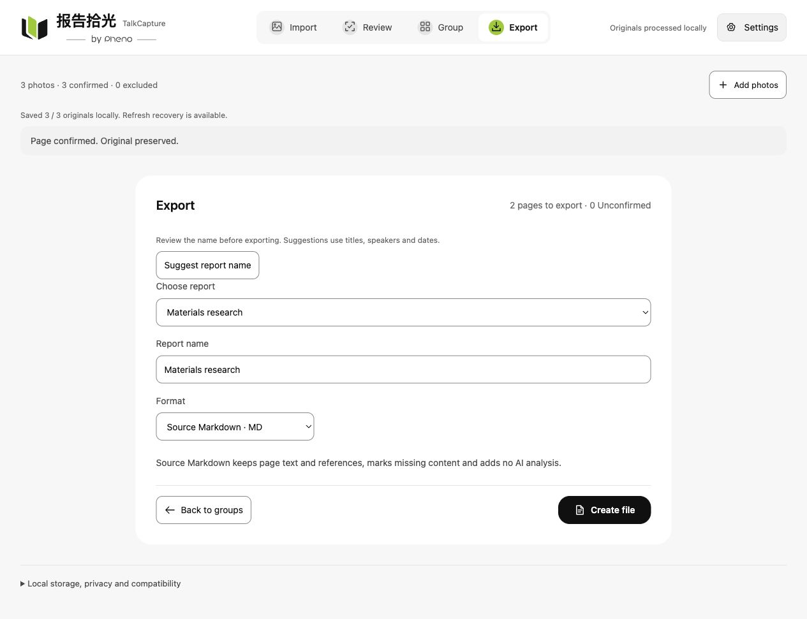
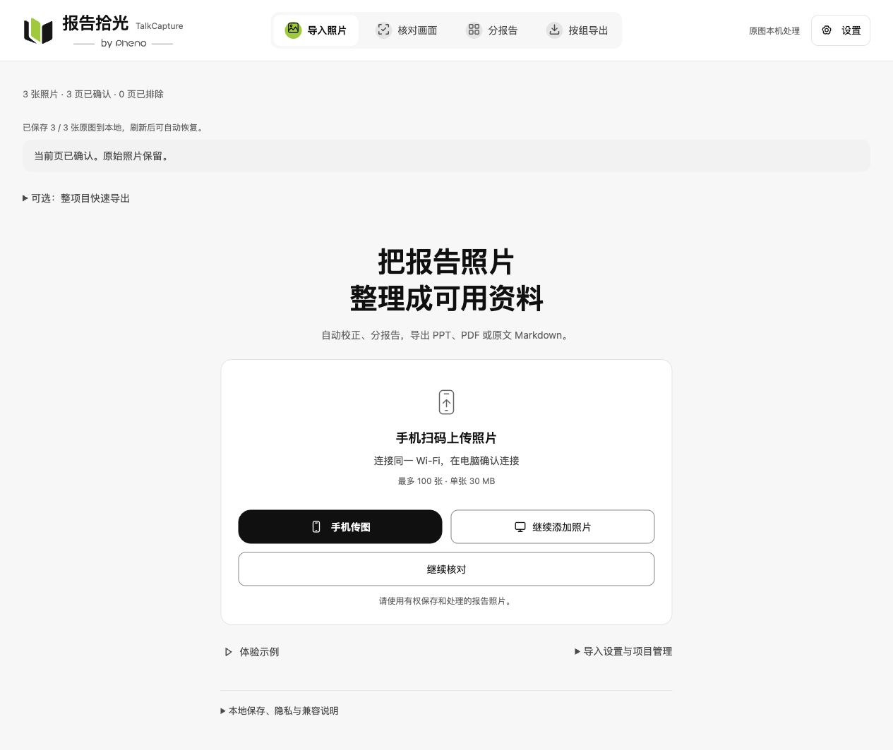

<p align="center"></p>

<h1 align="center">TalkCapture · 报告拾光</h1>
<p align="center"></p>
<p align="center"><a href="README.md">中文</a> · <a href="README.en.md">English</a></p>

**Turn slide photos scattered across your phone into material you can find, read, share, and reuse.**

For conferences, classes, and technical talks: correct photographed slides, review report groups and titles, then export PPT, PDF, or Markdown for reading, archiving, sharing, or use with your own AI agent.

> **0.1.0 — local development release.** Not publicly deployed. Detected corners, report groups, and titles are suggestions for review. Real multi-talk collections, physical phones, and large high-resolution batches still require acceptance testing.



_Actual interface with built-in synthetic slides. These screenshots do not establish accuracy on real reports._

## Why TalkCapture?

Taking a photo is easy. Turning it into useful material takes more work.

After an event, dozens or hundreds of slide photos remain in your phone’s gallery. Different talks are mixed together. Slides are tilted, surrounded by distracting backgrounds, and difficult to read on a small screen. Over time, they consume storage and become harder to find or identify.

Revisiting a talk means searching and correcting photos one by one. Sharing means sending a long stream of images. Using them with an AI agent requires extracting the text first.

TalkCapture bridges the gap between “I photographed it” and “I have organized material I can use.”

## Three core benefits

| Benefit                         | What it helps you do                                                                                                                 |
| ------------------------------- | ------------------------------------------------------------------------------------------------------------------------------------ |
| Reduce clutter on your phone    | Transfer photos to your computer and create independent archives; after verifying the archive, choose whether to remove phone copies |
| Make reports easier to read     | Review slide corners and corrected previews, then group, name, and order pages for continuous reading                                |
| Make captured material reusable | Download each report as PPT, PDF, or source-text Markdown for reading, sharing, or your own AI agent                                 |

TalkCapture never automatically deletes phone originals. Exported files are not guaranteed to be smaller than the source photos.

## From photos to reports

**Upload from phone or computer → Review images → Review groups and titles → Export each report**

### Group and name reports

Local text recognition suggests boundaries and names. Rename, split, merge, or move pages as needed. Content analysis stays behind an optional entry and does not run by default.



_Synthetic demo with manually adjusted groups and titles, showing the controls rather than measuring automatic grouping accuracy._

### Export what you need

| Format               | Use                                                 | What it contains                                                                                                             |
| -------------------- | --------------------------------------------------- | ---------------------------------------------------------------------------------------------------------------------------- |
| PPTX                 | Browse, present, and organize                       | Each slide contains a processed image; this does not recover the presenter’s original editable file                          |
| PDF                  | Read, archive, and share                            | Organized slide images                                                                                                       |
| Source-text Markdown | Search, analyze, or organize with your own AI agent | Page-by-page recognized text and source references without AI analysis; verify data, formulas, and charts against the images |



<details>
<summary>See the phone-first import entry</summary>



Pair on trusted Wi-Fi and approve the connection on the computer. No pairing session or QR credential is shown. This supplementary screenshot uses the Chinese interface.

</details>

## Capabilities and focus

- JPEG, PNG, HEIC / HEIF; up to 100 photos, 30 MB each, 1 GB total.
- Optional phone transfer with desktop approval: one phone, up to 10 minutes.
- Local corner suggestions, manual corners, perspective correction, rotation, brightness, and contrast; originals and manual edits are preserved.
- Reorder, exclude, and restore pages. Original files and editing metadata are cached locally and restored after refreshing once saved.
- Local macOS Vision OCR, suggested report groups, and per-report export. No recovery of obscured content, deduplication, or editable charts.

TalkCapture focuses on organizing source material. Deeper research, summarization, and knowledge management can continue in your own AI agent or other tools. Optional MiniMax analysis sends only the selected report’s recognized text and source-page references when explicitly invoked, never its images or other reports.

## Quick start

Requirements: Node.js 24 and pnpm. Keep the existing lockfile and dependency patch.

```sh
pnpm install --frozen-lockfile
pnpm build
pnpm start
```

Open <http://127.0.0.1:9015/?auto-crop=1>. The interface supports 中文 and English; choose your language in Settings. To explore the workflow, choose “体验示例” (Try demo). Demo images are generated by the application.

1. Select photos on the computer, or choose “手机传图” (Phone transfer), scan the QR code, and approve the connection on the desktop.
2. Review the automatically detected corners and previews; adjust and confirm inaccurate pages.
3. Continue to Group reports. Local text recognition suggests report boundaries and names; check the groups and edit, split or merge them as needed.
4. Export each selected report as image-based PPTX, PDF or source Markdown. Content analysis is available through a separate optional entry. Whole-project quick export remains an optional shortcut.

## Documentation

| Document                                          | Contents                                                                       |
| ------------------------------------------------- | ------------------------------------------------------------------------------ |
| [English user guide](docs/usage.en.md)            | Manual and batch workflows, phone pairing, recovery, image quality, and limits |
| [Bilingual introduction](docs/introduction.md)    | Reusable Chinese and English descriptions and confirmed product naming         |
| [Chinese user guide](docs/usage.md)               | Detailed current product behavior                                              |
| [Engineering guide, Chinese](docs/development.md) | Module map, processing paths, dependency patch, and local services             |
| [Validation record, Chinese](docs/validation.md)  | Development checks and acceptance boundaries                                   |
| [Roadmap, Chinese](docs/roadmap.md)               | Real photo, phone, large-image, and compatibility acceptance tasks             |
| [Engineering agreements, Chinese](AGENTS.md)      | Maintenance and data-protection rules                                          |

## Development checks

```sh
pnpm format
pnpm format:check
pnpm typecheck
pnpm test
pnpm build
pnpm test:browser
pnpm start
```

Use `pnpm dev` while editing source files. `pnpm preview` runs the same service as `pnpm start`. All three use port 9015 and cannot run simultaneously. Browser tests require Playwright Chromium and start an isolated built service on ports 9025/9026 without reusing the user’s transfer session. Standalone ESLint is not configured.

## Local data and privacy

Image correction, previews, and document generation run in the desktop browser. Original files are not overwritten. The browser database caches original files separately from editing metadata. Once saving completes, refreshing restores the originals and edits. Legacy entries or cleared browser data may require supplying the originals again.

Phone transfer is optional and only starts when explicitly enabled. Its local HTTP connection is unencrypted, so it is suitable only for non-sensitive material on trusted Wi-Fi. It must not be exposed to the public internet. Phone files are temporarily stored on the computer during transfer; abnormal termination may leave temporary files. See the [user guide](docs/usage.en.md) for details.

The repository contains source, tests, documentation, lockfiles, and the dependency patch. Real photos, generated PPT/PDF files, browser project data, credentials, local environment files, and test artifacts stay outside version control.

The Settings panel configures the MiniMax model and server-side API key, tests saved credentials using a fixed message, and provides light/dark/system themes, three text sizes, app version and build time. Existing keys are never returned to the page. Display preferences stay in the current browser.

The primary workflow is Import → Review → Group and name reports → Export by report. Source Markdown preserves full page text and original page references without AI analysis. MiniMax analysis and whole-project quick export are optional.
