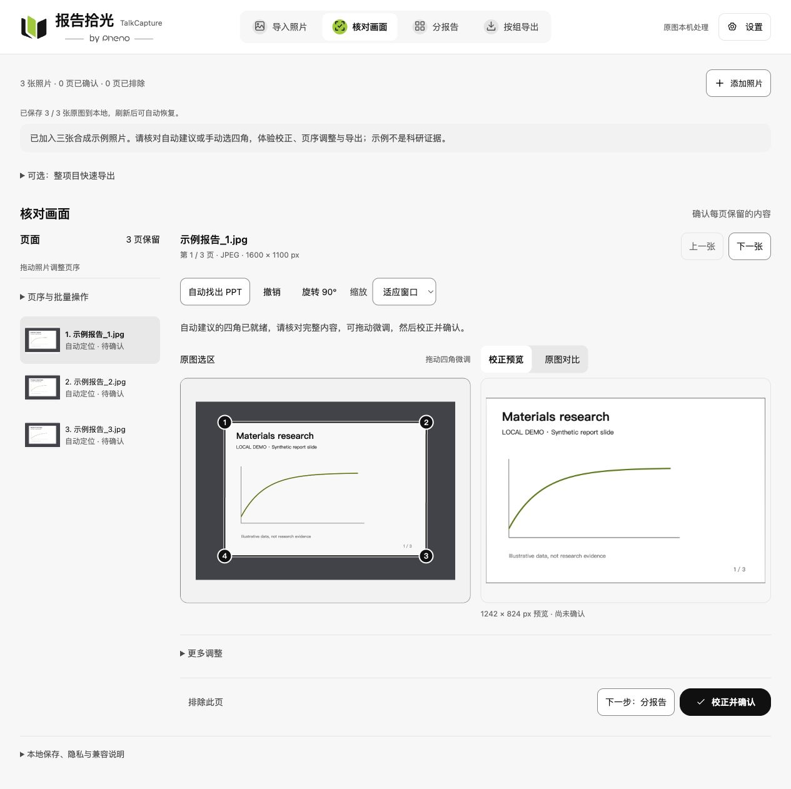
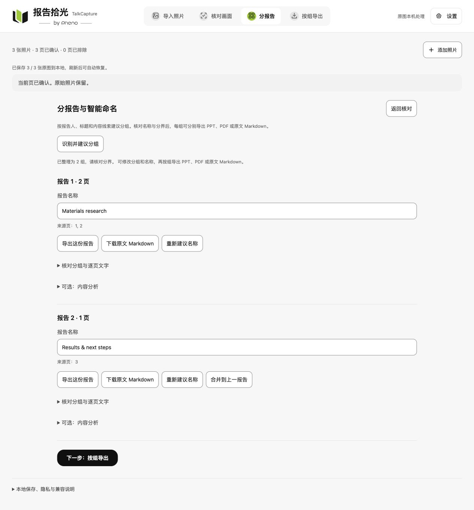
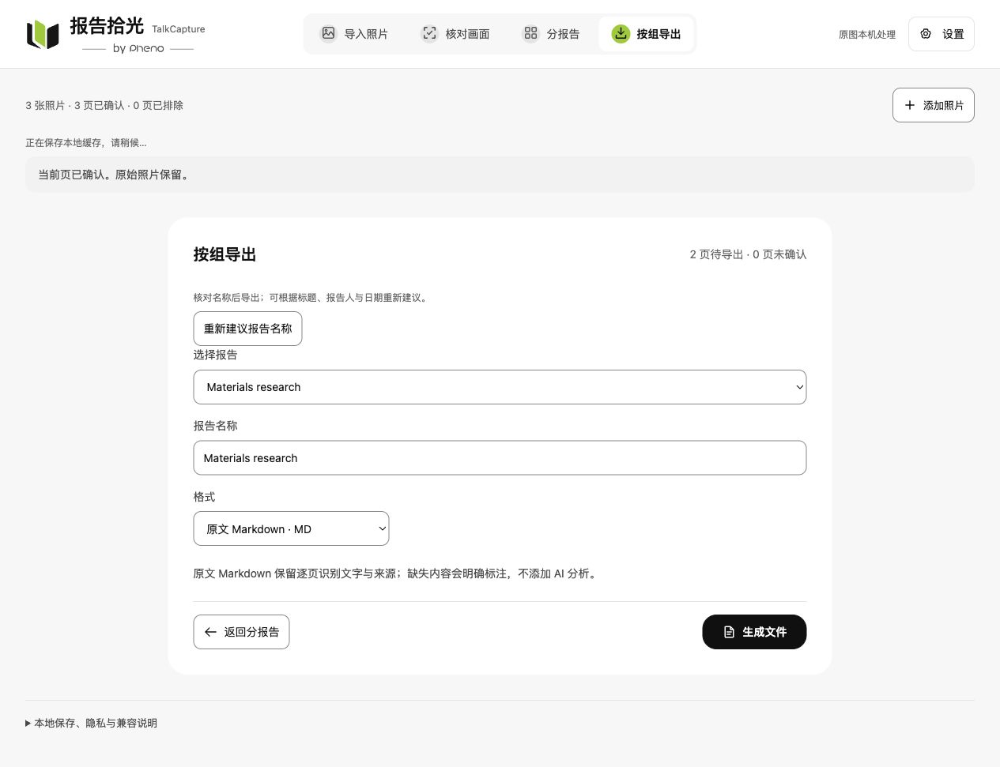

<p align="center"></p>

<h1 align="center">报告拾光 · TalkCapture</h1>
<p align="center"></p>
<p align="center"><a href="README.md">中文</a> · <a href="README.en.md">English</a></p>

**把散落在手机里的报告照片，整理成找得到、看得清、带得走、能继续使用的资料。**

面向学术会议、课堂学习与技术交流，将手机拍下的幻灯片经过画面校正、分组和命名，整理为便于阅读、归档、分享和交给自己 Agent 使用的 PPT、PDF 或 Markdown。

> 当前为 **0.1.0 本地开发版**，尚未公开部署。自动找角、分组与命名均为待核对建议；真实多报告批次、实体手机及大量高清照片仍需用户验收。



_截图使用内置合成示例，展示实际界面与处理预览，不代表真实报告的识别准确率。_

## 为什么做报告拾光？

听报告时，我们常常会拍下有价值的幻灯片。但拍下来，并不意味着资料已经整理好了。

活动结束后，几十甚至几百张照片留在手机相册里：不同报告混在一起，画面倾斜、背景杂乱，小字需要反复放大。时间一久，既占用手机空间，也很难记起照片属于哪位报告人、讲了什么。想回看，需要逐张寻找和校正；想分享，需要发送一长串图片；想交给自己的 Agent，还需要提取文字。

报告拾光从这些实际问题出发，帮助用户从“拍下来了”，走到“整理好了、可以使用了”。

## 三个核心价值

| 价值               | 帮你完成的事情                                                                    |
| ------------------ | --------------------------------------------------------------------------------- |
| 让手机相册轻下来   | 将报告照片传到电脑整理，形成独立归档文件；确认完整保存后，可自行清理手机照片      |
| 让报告重新可读     | 核对四角与校正预览，将零散照片按报告分组、命名和排序，便于连续翻阅                |
| 让资料继续发挥作用 | 按报告下载 PPT、PDF 或带来源页码的原文 Markdown，用于阅读、分享或交给自己的 Agent |

工具不会自动删除手机原图；导出文件也不保证比原照片更小。

## 从照片到报告

**手机或电脑上传 → 核对画面 → 核对分组与名称 → 按报告导出**

### 分报告与命名

本机文字识别建议报告分界和名称，可人工改名、拆分、合并或移动页面。内容分析收在可选入口，默认不运行。



_合成演示：分界和名称经人工调整，用于展示分组操作，并非自动分组效果评测。_

### 每份报告，各取所需

| 格式          | 用途                              | 内容边界                                                           |
| ------------- | --------------------------------- | ------------------------------------------------------------------ |
| PPTX          | 逐页浏览、展示与整理              | 每页是一张处理后的图片，并非报告人的原始可编辑文件                 |
| PDF           | 阅读、归档和分享                  | 保留整理后的页面画面                                               |
| 原文 Markdown | 交给自己的 Agent 检索、分析和整理 | 逐页识别文字与来源页码，不混入 AI 分析；数据、公式与图表需对照原图 |



<details>
<summary>查看手机上传入口</summary>


同一可信 Wi-Fi 下扫码，在电脑批准连接后上传。截图未开启配对，不包含二维码或连接凭据。

</details>

## 当前能力与产品取舍

- JPEG、PNG、HEIC / HEIF；最多 100 张，单张 30 MB，总计 1 GB。
- 手机扫码传图：电脑批准，一次一台手机，连接最长 10 分钟。
- 本地找角建议、手动四角、透视校正、旋转、亮度与对比度；保留原图及人工调整。
- 导入页照片墙、大图浏览和收起；批量核对总览、问题列表及疑似重复页提示。
- 调整页序、排除与恢复，原图和编辑参数本地缓存，保存完成后刷新恢复。
- 本机 macOS Vision OCR 建议分组，按报告导出；不恢复遮挡内容或可编辑图表；疑似重复仅提示，由用户决定保留。

产品聚焦于资料整理。深入研究、总结和知识管理可交给用户自己的 Agent 或其他工具。MiniMax 内容分析是可选能力，仅主动调用时发送所选报告的识别文字与来源页码，不发送原图或其他报告。

## 开始使用

需要 Node.js 24 和 pnpm，安装遵循现有锁文件。当前文字识别和自动分报告依赖 macOS Vision 与 Swift 命令行工具；其他系统尚未实现这条本机识别路径。MiniMax 仅为可选分析，基础整理与导出无需配置密钥。

```sh
pnpm install --frozen-lockfile
pnpm build
pnpm start
```

打开 <http://127.0.0.1:9015/?auto-crop=1>。首次可点击“体验示例”，示例由程序生成。

1. 点击“手机传图”，扫码并在电脑批准连接后上传；也可从电脑选择。
2. 自动找四角并生成预览，逐页微调并确认。
3. 点击“下一步：分报告”，本机识别文字并建议分组和名称；核对分界，可拆分、合并或移动页。
4. 选择一份报告，导出 PPTX、PDF 或原文 Markdown；也可展开批量导出，选择多组与多种格式统一打包。图像文件保留画面，Markdown 保留逐页文字及来源，不混入分析。

设置中提供项目备份与恢复：保存全部原图、选区、分组与页序，不包含模型密钥。恢复前会校验并要求确认替换；浏览器缓存不能替代已下载的备份。当前备份与单个导出压缩包上限512 MB。

“可选：内容分析”提供 MiniMax 解读；“可选：整项目快速导出”保留兼容的一键整理入口，均不属于主流程。

每组显示代表缩略图；逐页识别文字和次级操作按需展开。设置优先显示语言、主题和字号，模型配置默认折叠。

## 项目文档

| 文档                                  | 内容                                         |
| ------------------------------------- | -------------------------------------------- |
| [文档导航](docs/README.md)            | 当前文档职责、源码导航与实测准备             |
| [更新记录](CHANGELOG.md)              | 最近三批整理与对应提交                       |
| [新一轮实测清单](docs/acceptance.md)  | 手机上传、多报告核对、三种导出及刷新恢复     |
| [产品范围与使用方法](docs/usage.md)   | 逐页与自动流程、手机传图、恢复方式和图像质量 |
| [工程结构与维护](docs/development.md) | 代码模块、处理路径、依赖补丁和本地运行方式   |
| [验证记录](docs/validation.md)        | 历史开发自测、本次检查和验收边界             |
| [后续计划与验收](docs/roadmap.md)     | 真实批量照片、真机、大图和文件兼容的验收清单 |
| [工程约定](AGENTS.md)                 | 维护时必须遵守的产品与数据保护规则           |

正式名称与对外介绍见 [中英文项目介绍](docs/introduction.md)。英文入口见 [English README](README.en.md) 和 [English user guide](docs/usage.en.md)。工具界面支持中文与 English，可在设置中切换。

早期界面优化及技能来源见 [界面优化记录](docs/ui-refinement.md)。

## 开发检查

```sh
pnpm format
pnpm format:check
pnpm typecheck
pnpm test
pnpm build
pnpm test:browser
pnpm start
```

修改代码时运行 `pnpm dev`；`pnpm preview` 与 `pnpm start` 相同。三个入口共用 9015 端口，不能同时启动。浏览器测试需要 Playwright Chromium；测试自动在 9025/9026 启动独立构建服务，不复用用户的传图会话。独立 ESLint 尚未配置。

## 数据与仓库范围

照片校正、预览和导出在本机浏览器中完成，原图不覆盖，编辑参数保存在浏览器本地数据库中。手机传图只在用户显式开启后使用本机局域网网关；当前 HTTP 传输不加密，只适合可信 Wi-Fi 下的非敏感材料。

本仓库维护源码、测试、锁文件、依赖补丁和项目文档。真实照片、生成的 PPT/PDF、浏览器数据、凭据、环境文件和测试生成物留在本地。仓库备份不包含照片或浏览器中的编辑项目。

右上角「设置」可配置 MiniMax 模型与密钥、测试已保存配置，选择浅色/深色/跟随系统和三档字号，并查看软件版本与构建时间。已有密钥不回显，页面保存到电脑端；显示偏好记住在当前浏览器。

界面支持中文与 English，在「设置 → 语言 / Language」即时切换并记住选择。手机扫码页面可继承语言或独立切换，原始文件名与识别原文保持不变。

## 开源许可

本项目采用 [MIT 许可证](LICENSE)，版权署名为 **pheno**。允许使用、修改、分发及商用，须保留版权与许可声明；软件按原样提供，不作担保。第三方依赖仍遵循各自的许可证；上传的报告与照片的权利归其原权利人所有。
